# Hi, I'm Tanish Tiwari

### Data Science Student • Python Developer • AI/ML Enthusiast

Building intelligent, data-driven systems and turning ideas into real-world solutions.

 

  

---

# About Me

I'm a **B.Sc. Data Science student** focused on building practical solutions using **Python, Data Science, Artificial Intelligence and Machine Learning**.

I enjoy taking ideas from concept to implementation — combining data, software engineering and intelligent systems to create useful real-world applications.

- Currently learning **Machine Learning, Data Science, AI/ML and Backend Development**
- Exploring **Computer Vision, Intelligent Systems and Real-Time Applications**
- Interested in **AI-powered products and data-driven systems**
- Open to collaborating on **AI, ML, Data Science and software projects**
- Ask me about **Python, Data Science, Machine Learning and AI**
- I enjoy turning ideas into working projects

---

# Tech Stack

### Programming

&nbsp;&nbsp;&nbsp;

  

### Data Science & AI

&nbsp;&nbsp;&nbsp;

&nbsp;&nbsp;&nbsp;

  

### Development & Tools

&nbsp;&nbsp;&nbsp;

&nbsp;&nbsp;&nbsp;

&nbsp;&nbsp;&nbsp;

&nbsp;&nbsp;&nbsp;

&nbsp;&nbsp;&nbsp;

---

# GitHub Analytics

<picture>
  <source
    media="(prefers-color-scheme: dark)"
    srcset="./profile-cards/overview.dark.svg"
  >
  
</picture>

---

# Contribution Activity

<picture>
  <source
    media="(prefers-color-scheme: dark)"
    srcset="./profile-cards/contributions.dark.svg"
  >
  
</picture>

---

# Contribution History

<picture>
  <source
    media="(prefers-color-scheme: dark)"
    srcset="./profile-cards/lifetime.dark.svg"
  >
  
</picture>

---

# GitHub Activity Rhythm

<picture>
  <source
    media="(prefers-color-scheme: dark)"
    srcset="./profile-cards/rhythm.dark.svg"
  >
  
</picture>

---

# GitHub Overview

<picture>
  <source
    media="(prefers-color-scheme: dark)"
    srcset="./profile-cards/repositories.dark.svg"
  >
  
</picture>

  

<picture>
  <source
    media="(prefers-color-scheme: dark)"
    srcset="./profile-cards/languages.dark.svg"
  >
  
</picture>

---

# Featured Projects

<table>
<tr>

<td width="50%" valign="top">

## GatiRaksha

**Intelligent Traffic Management & Navigation System**

A smart traffic-management platform focused on real-time incident handling, traffic intelligence, dynamic routing, emergency response and map-based navigation.

 

`AI/ML` `Computer Vision` `Real-Time Systems`

`Maps` `Routing` `Traffic Intelligence`

  

</td>

<td width="50%" valign="top">

## Data Science

**Data-Driven Projects & Experiments**

Exploring data analysis, machine learning, predictive modelling, visualization and intelligent systems through practical implementations.

 

`Python` `Data Science` `Machine Learning`

`Artificial Intelligence` `Data Analysis`

  

</td>

</tr>
</table>

---

# What I'm Exploring

| Area | Focus |
|:---:|:---|
| Artificial Intelligence | Intelligent applications and AI systems |
| Machine Learning | Predictive models and practical ML |
| Data Science | Data analysis, visualization and insights |
| Computer Vision | Real-time visual intelligence |
| Intelligent Systems | AI-powered real-world solutions |
| Backend Development | APIs, services and scalable systems |
| Real-Time Applications | Live data and event-driven systems |

---

# Current Focus

<table>
<tr>

<td width="50%" valign="top">

### GatiRaksha

Building an intelligent traffic platform with:

- Real-time incident handling
- Dynamic route management
- Traffic intelligence
- Emergency alerts
- Map-based navigation
- AI/ML integration

</td>

<td width="50%" valign="top">

### Data Science

Currently strengthening:

- Python
- Statistics
- Data Analysis
- Machine Learning
- Model Evaluation
- Data Visualization
- AI Systems

</td>

</tr>
</table>

---

# Connect With Me

  

### Build. Learn. Improve. Repeat.

