# Hi, I'm Tanish Tiwari

### Data Science Student | Python Developer | AI/ML Enthusiast | Building Intelligent Systems

  
  
  

---

## About Me

I'm a **B.Sc. Data Science student** focused on building practical software, data-driven applications and intelligent systems.

I enjoy working at the intersection of **Data Science, Artificial Intelligence, Machine Learning and Software Development**.

- Currently building **GatiRaksha**, an intelligent traffic management and navigation platform
- Learning and strengthening **Python, Data Science, Machine Learning and AI**
- Interested in **real-time systems, computer vision and intelligent applications**
- Building projects that combine **data, automation and real-world problem solving**
- Continuously improving my development, analytical and problem-solving skills

---

## Tech Stack

### Languages

  
  
  
  

### Data Science & AI

  
  
  
  

### Development & Tools

  
  
  
  
  

---

## GitHub Analytics

<picture>
  <source media="(prefers-color-scheme: dark)" srcset="./profile-cards/overview.dark.svg">
  
</picture>

---

## Contribution Streak

<picture>
  <source media="(prefers-color-scheme: dark)" srcset="./profile-cards/contributions.dark.svg">
  
</picture>

---

## Contribution Activity

<picture>
  <source media="(prefers-color-scheme: dark)" srcset="./profile-cards/momentum.dark.svg">
  
</picture>

---

## Contribution History

<picture>
  <source media="(prefers-color-scheme: dark)" srcset="./profile-cards/lifetime.dark.svg">
  
</picture>

---

## Repository & Language Overview

### Repositories

<picture>
  <source media="(prefers-color-scheme: dark)" srcset="./profile-cards/repositories.dark.svg">
  
</picture>

### Languages

<picture>
  <source media="(prefers-color-scheme: dark)" srcset="./profile-cards/languages.dark.svg">
  
</picture>

---

## Featured Projects

| Project | Description | Technologies |
|:---|:---|:---|
| **[GatiRaksha](https://github.com/TanishhTiwarii/GatiRaksha)** | Intelligent traffic management and navigation platform focused on real-time incidents, traffic intelligence and dynamic routing. | Python, AI/ML, Maps, Real-Time Systems |
| **Data Science Projects** | Practical projects focused on data analysis, machine learning, visualization and predictive modelling. | Python, Pandas, NumPy, Scikit-learn |

---

## What I'm Exploring

| Area | Focus |
|:---|:---|
| Artificial Intelligence | Intelligent applications and AI systems |
| Machine Learning | Predictive models and practical ML |
| Data Science | Data analysis, visualization and insights |
| Computer Vision | Real-time visual intelligence |
| Intelligent Systems | AI-powered real-world solutions |
| Backend Development | APIs, services and scalable systems |
| Real-Time Applications | Live data and event-driven systems |

---

## Current Focus

| GatiRaksha | Data Science |
|:---|:---|
| **Building an intelligent traffic management and navigation platform** with:  • Real-time incident handling • Dynamic route management • Traffic intelligence • Emergency alerts • Map-based navigation • AI/ML integration | **Currently strengthening:**  • Python • Statistics • Data Analysis • Machine Learning • Model Evaluation • Data Visualization • AI Systems |

---

## Development Philosophy

I believe in learning by building.

My approach is simple:

**Learn → Build → Test → Improve → Repeat**

I focus on understanding the problem first, choosing the right technology for it, and then building solutions that are practical, maintainable and useful in real-world scenarios.

---

## Currently Learning

- Advanced Python
- Data Analysis
- Statistics for Data Science
- Machine Learning
- Model Evaluation
- Data Visualization
- Artificial Intelligence
- Computer Vision
- Backend Development
- Real-Time Systems

---

## Connect With Me

  
  
  
  

---

## GitHub Profile

  

  <b>Building skills. Building projects. Building systems.</b>

